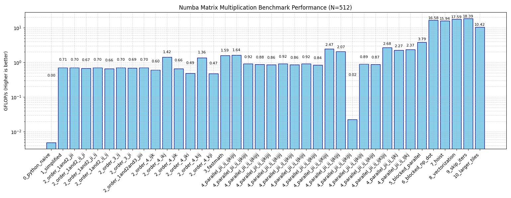
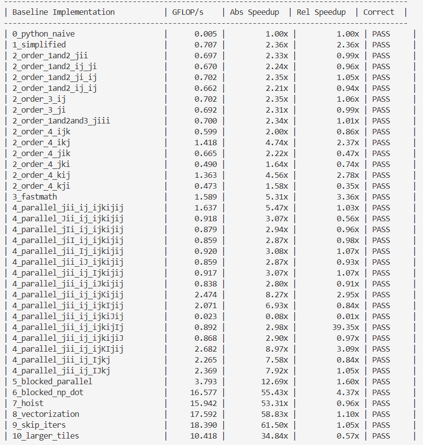

# Correlation example

Correlation computation measures how strongly two variables move together, as a number between -1 and 1. Essentially the _correlation_ between two variables.

Correlation can be defined as:
- +1: they rise and fall together in perfect lockstep (linear relationship).
- 0: no linear relationship.
- -1: when one rises, the other falls in perfect lockstep.

In our example today we are looking at a table with 512 columns (i.e. variables). Classic implementation of correlation in python would require that we compare every column with every other column and fill a 512 x 512 grid. Each cell holds the correlation between two variables. The diagonal is always 1, because a variable would always perfectly match itself. The grid is a mirror image of itself across the diagonal, because “A vs B” is going to have the same correlation value as “B vs A”.

In the code implementation we:
- calculate mean: to know what the "average" is across all variables so we have a benchmark to compare variables against one another with
- center data: centers the data around 0 by subtracting the mean from each of the values
- calculate standard deviation and scale data: work together to adjust the scores to be between +1 and -1
- iterate over the correlation matrix: compare each pair and assign a score

## Code optimization

The optimization story behind `benchmarks/corr_bench.py` follows the same
workflow as GEMM: start with a
slow reference kernel, then progressively improve locality, backend
compilation, and parallelism until the
execution pattern matches the hardware more closely.

The kernel computes the correlation matrix of an `N x M` data matrix
(`N` samples, `M` variables). It has four stages: column means, column
standard deviations, centering and scaling of the data, and the `M x M`
correlation matrix itself. The last stage costs about `N*M^2/2`
multiply-adds and dominates the runtime; the first three are `O(N*M)`.
Only the upper triangle is computed and then mirrored into the lower
triangle.

### 0- naive baseline

The simplest implementation is the direct loop nest:

```python
def correlation_python_0(data, corr, mean, stddev):
    n, m = data.shape
    float_n = float(n)

    # Column means
    for j in range(m):
        s = 0.0
        for i in range(n):
            s += data[i, j]
        mean[j] = s / float_n

    # Column standard deviations
    for j in range(m):
        s = 0.0
        for i in range(n):
            d = data[i, j] - mean[j]
            s += d * d
        s /= float_n
        s = s ** 0.5
        stddev[j] = 1.0 if s <= EPS else s

    # Center and reduce the data
    for i in range(n):
        for j in range(m):
            data[i, j] -= mean[j]
            data[i, j] /= (float_n ** 0.5) * stddev[j]

    # Correlation matrix (upper triangle, mirrored)
    for i in range(m - 1):
        corr[i, i] = 1.0
        for j in range(i + 1, m):
            s = 0.0
            for k in range(n):
                s += data[k, i] * data[k, j]
            corr[i, j] = s
            corr[j, i] = s
    corr[m - 1, m - 1] = 1.0
```

This version is easy to verify and matches the mathematical definition,
but it is dominated by Python-level
loop overhead and poor memory access patterns. Every `data[k, i]` creates a
NumPy scalar object, so it is orders of magnitude slower than optimized
numerical kernels. The benchmark runs it on a smaller problem size (matrix dimension N = 512) so it finishes quickly.

The reference result is `np.corrcoef(data, rowvar=False)`. Note that the
kernel normalizes `data` in place, so the benchmark passes a fresh copy on
every call.

### 1- loop fusion, njit

The first major improvement is to move the computation into Numba
JIT code:

```python
@njit
def correlation_numba_1(data, corr, mean, stddev):
    n, m = data.shape
    float_n = float(n)

    # Column means
    for j in range(m):
        s = 0.0
        for i in range(n):
            s += data[i, j]
        mean[j] = s / float_n

    # Column standard deviations
    for j in range(m):
        s = 0.0
        for i in range(n):
            d = data[i, j] - mean[j]
            s += d * d
        s /= float_n
        s = s ** 0.5
        stddev[j] = 1.0 if s <= EPS else s

    # Center and reduce the data
    for i in range(n):
        for j in range(m):
            data[i, j] -= mean[j]
            data[i, j] /= (float_n ** 0.5) * stddev[j]

    # Correlation matrix (upper triangle, mirrored)
    for i in range(m - 1):
        corr[i, i] = 1.0
        for j in range(i + 1, m):
            s = 0.0
            for k in range(n):
                s += data[k, i] * data[k, j]
            corr[i, j] = s
            corr[j, i] = s
    corr[m - 1, m - 1] = 1.0
```

Numba compiles the loop nest to machine code, eliminating much of the
Python overhead. The algorithm is still
the same, but the kernel now runs efficiently on the CPU. This is the
point at which we see a jump in
throughput without changing the mathematical structure.

### 2- loop order permutations

The next optimization is loop reordering. The naive correlation nest uses
`i, j, k` order; the benchmark also compares
the other permutations of the nest (`i, k, j`, `j, i, k`, `j, k, i`,
`k, i, j`, `k, j, i`) and the `i, j` versus `j, i` order of the
mean, standard deviation, and center and reduce data passes.

Due to the variations in runtime results across runs, the average GFLOPS over 5 runs was taken for each of the loop exchange permutations. 

The following table highlights the average GFLOPS for permutations across the first two loops: mean and standard deviation calculations:

| Permutation name     | Mean | Std dev | Combined? | GFLOPS |
| -------------------- |------|---------|-----------| ------ |
| 3_order_1and2_jii    | ji   | ji      | Y         | 0.6604 |
| 3_order_1and2_ij_ji  | ij   | ji      | N/A       | 0.6132 |
| 3_order_1and2_ji_ij  | ji   | ij      | N/A       | 0.6464 |
| 3_order_1and2_ij_ij  | ij   | ij      | N         | 0.6138 |

It was found that *3_order_1and2_jii* performs the best of all the permutations of the first two loops. With respect to the third loop (i.e. center and reduce data), the same analysis was performed in order to evaluate performance between permutations:

| Permutation name     | Cntr+red | Combined? | run 1 | run 2 | run 3 | run 4 | run 5 | avg |
| -------------------- |----------|-----------| ----- | ----- | ----- | ----- | ----- | ----- |
|3_order_3_ij          | ij       | N/A       | 0.497 | 0.566 | 0.597 | 0.550 | 0.577 | 0.5574
|3_order_3_ji          | ji       | N         | 0.554 | 0.580 | 0.521 | 0.576 | 0.585 | 0.5632
|3_order_1and2and3_jiii| ji       | Y         | 0.530 | 0.505 | 0.541 | 0.582 | 0.599 | 0.5514

It was found that *3_order_3_ji* was the most efficient of the permutations 40% of the time and it had the highest average GFLOPS of the permutations of the last loop. With respect to the fourth and final loop (i.e. the correlation matrix), the same analysis was performed in order to evaluate performance between permutations. For brevity, only data from the top 2 performing permutations will be included:

| Permutation   | Corr mtx | run 1 | run 2 | run 3 | run 4 | run 5 | avg    |
| ------------- |----------|-------|-------|-------|-------|-------| ------ |
| 3_order_4_ikj | ikj      | 1.302 | 1.250 | 1.079 | 1.082 | 1.221 | 1.1868 |
| 3_order_4_kij | kij      | 1.212 | 1.287 | 1.292 | 1.244 | 1.315 | 1.2700 |

It was found that kij outperforms ikj 80% of the time, and has a better overall GFLOPS score. 

Thus, the permutations selected were:
- mean: ji
- standard deviation: ji (j in std dev combined with the j in mean)
- center & reduce: ji
- correlation matrix: kij

```python
def correlation_opt_flags_3(data, corr, mean, stddev): #j(ii) ji kij
    n, m = data.shape
    float_n = float(n)

    for j in range(m):
        # column means
        s = 0.0
        for i in range(n):
            s += data[i, j]
        mean[j] = s / float_n

        # column std devs
        s = 0.0
        for i in range(n):
            d = data[i, j] - mean[j]
            s += d * d
        s = (s / float_n) ** 0.5
        stddev[j] = 1.0 if s <= EPS else s

    # Center and reduce the data
    for j in range(m):
        for i in range(n):
            data[i, j] -= mean[j]
            data[i, j] /= (float_n ** 0.5) * stddev[j]

    # Correlation matrix (upper triangle, mirrored)
    for i in range(m):
        corr[i, i] = 1.0
        for j in range(i + 1, m):
            corr[i, j] = 0.0

    for k in range(n):
        for i in range(m - 1):
            dki = data[k, i]
            for j in range(i + 1, m):
                corr[i, j] += dki * data[k, j]

    for i in range(m - 1):
        for j in range(i + 1, m):
            corr[j, i] = corr[i, j]
```

The benefit comes from locality and reuse. With the `i, k, j` order, the
inner `j` loop reads `data[k, j]` and updates `corr[i, j]`
contiguously, and `data[k, i]` is hoisted out of the loop. In the
`i, j, k` order the inner `k` loop strides down two columns of `data`.
The price is that the accumulator moves from a register into `corr`,
so each `corr[i, j]` must be zeroed first and the mirror into
`corr[j, i]` has to wait until the `k` loop finishes.

The mean and standard deviation passes follow the same rule: with `i`
outer and `j` inner the accesses are contiguous, but the sums
accumulate into `mean[j]` and `stddev[j]`, and the two passes can no longer
be fused because every mean must be final before any deviation is computed.

As a general rule, loop order matters because the innermost loop
determines the stride pattern of memory
access. Reordering loops is often the simplest way to improve a
cache-friendly kernel.

### 3- compiler flag: fastmath

Once the loop nest is structurally good, the next step is to let the
backend aggressively optimize it:

```python
@njit(fastmath=True)
def correlation_opt_flags_3(data, corr, mean, stddev):
    # same body as above
    ...
```

`fastmath=True` enables mathematically aggressive optimizations such as
reassociation and vectorization-friendly
transformations. These can increase throughput for floating-point
kernels, especially when the code is
numerically well-behaved and the result tolerances are not overly
strict.

This optimization does not change the algorithm; it changes how the
compiler is allowed to transform the kernel.
It is a pure backend optimization, not a rewrite of the correlation formula.

### 4- parallelism

A high-level parallelism improvement is to parallelize the outer loop
of the correlation nest with `prange`:

| Permutation name          | run 1 | run 2 | run 3 | run 4 | run 5 | avg   |
|---------------------------|-------|-------|-------|-------|-------|-------|
| 5_parallel_jii_ij_ijkijij | 1.308 | 1.418 | 1.521 | 1.764 | 1.843 | 1.571 |
| 5_parallel_jii_ij_ijKijij | 1.392 | 1.995 | 2.195 | 2.324 | 2.141 | 2.009 |
| 5_parallel_jii_ij_ijkIjij | 1.408 | 1.419 | 2.055 | 2.041 | 2.076 | 1.800 |
| 5_parallel_jii_ij_ijKIjij | 1.632 | 2.007 | 2.499 | 1.960 | 2.151 | 2.050 |
| 5_parallel_jii_ij_Ijkj    | 1.667 | 1.627 | 2.583 | 2.294 | 2.237 | 2.082 |
| 5_parallel_jii_ij_IJkj    | 1.547 | 1.602 | 2.840 | 2.431 | 2.295 | 2.143 |

It was found that "IJkj" (permutation IJK, iterating over i and j in parallel) outperforms the rest of the parallelisms 60% of the time, and has the highest average GFLOPS score. This is because while the KIJ permutation outperformed IJK, as seen during the permutations round of optimization; the overhead cost to set up the chunks in order to prevent race conditions and allow k to run in parallel is very expensive. Conversely, the simple IKJ order performs very well in parallel when iterating over i in parallel, beating the KIJ configuration.Therefore, we're going to overrule the previous permutation choice and update out loop order selection to ikj, iterating over i and j in parallel

```python
@njit(parallel=True, fastmath=True)
def correlation_parallel_IJkj_4(data, corr, mean, stddev): #jii ij IJkj
    n, m = data.shape
    float_n = float(n)

    for j in range(m):
        # column means
        s = 0.0
        for i in range(n):
            s += data[i, j]
        mean[j] = s / float_n

        # column std devs
        s = 0.0
        for i in range(n):
            d = data[i, j] - mean[j]
            s += d * d
        s = (s / float_n) ** 0.5
        stddev[j] = 1.0 if s <= EPS else s

    # Center and reduce the data
    for i in range(n):
        for j in range(m):
            data[i, j] -= mean[j]
            data[i, j] /= (float_n ** 0.5) * stddev[j]

    # Correlation matrix (upper triangle, mirrored)
    for i in prange(m - 1):
        corr[i, i] = 1.0

        for j in prange(i + 1, m):
            corr[i, j] = 0.0

        for k in range(n):
            dki = data[k, i]
            for j in range(i + 1, m):
                corr[i, j] += dki * data[k, j]

        for j in range(i + 1, m):
            corr[j, i] = corr[i, j]

    corr[m - 1, m - 1] = 1.0
```

### 5- tiling parallel

The next optimization is loop tiling. Instead of processing the entire matrix in one pass, we work on sub-blocks that fit better into cache. Here, we use a helper function to maintain code readability and SRP , but we use the annotation inline='always' to indicate to the compiler that this helper function should actually be treated as inline code rather than a separate function, in order to keep excess overhead costs low. We use a tile size of 32 as it fits in L1, and is a factor of 512 producing 16 blocks which can distribute the work across 4 cores. Larger tiles may produce fewer tiles and consequently uneven work load across cores. 

``` python
@njit(inline='always', fastmath=True)
def _block_helper(data, corr, b, bs):
    n, m = data.shape
    i0 = b * bs
    i1 = min(i0 + bs, m)

    # Diagonal and zero accumulators for this block's rows
    for i in range(i0, i1):
        corr[i, i] = 1.0
        for j in range(i + 1, m):
            corr[i, j] = 0.0

    # Tiled i, k, j accumulation (upper triangle only)
    for k0 in range(0, n, bs):
        k1 = min(k0 + bs, n)
        for j0 in range(i0, m, bs):
            j1 = min(j0 + bs, m)
            for i in range(i0, i1):
                js = max(j0, i + 1)
                for k in range(k0, k1):
                    dki = data[k, i]
                    for j in range(js, j1):
                        corr[i, j] += dki * data[k, j]

@njit(parallel=True, fastmath=True)
def correlation_blocked_parallel_5(data, corr, mean, stddev):
    n, m = data.shape
    float_n = float(n)
    bs = BLOCK_SIZE

    for j in range(m):
        # column means
        s = 0.0
        for i in range(n):
            s += data[i, j]
        mean[j] = s / float_n

        # column std devs
        s = 0.0
        for i in range(n):
            d = data[i, j] - mean[j]
            s += d * d
        s = (s / float_n) ** 0.5
        stddev[j] = 1.0 if s <= EPS else s

    # Center and reduce the data
    for i in range(n):
        for j in range(m):
            data[i, j] -= mean[j]
            data[i, j] /= (float_n ** 0.5) * stddev[j]

    # Correlation matrix (upper triangle, mirrored)
    nb = (m + bs - 1) // bs

    # Parallel over I blocks. Pair block p (most work) with block nb-1-p
    # (least work) so every iteration costs about the same.
    for p in prange((nb + 1) // 2):
        _block_helper(data, corr, p, bs)
        q = nb - 1 - p
        if q != p:
            _block_helper(data, corr, q, bs)

    # Tiled mirror: thread b writes only columns i0..i1 of the lower triangle
    for b in prange(nb):
        i0 = b * bs
        i1 = min(i0 + bs, m)
        for j0 in range(i0, m, bs):
            j1 = min(j0 + bs, m)
            for i in range(i0, i1):
                for j in range(max(j0, i + 1), j1):
                    corr[j, i] = corr[i, j]
```

The key idea is to split the computation into tiles of size
`BLOCK_SIZE`, so each tile of `data` and `corr`
fits in cache instead of streaming huge sections of the matrices through
memory. Because only the upper triangle is needed, the `j` tiles start at
the diagonal tile and the diagonal tile is trimmed so only `j > i` is
touched.

The benchmark also explores blocked variants that use `np.dot` on
sub-blocks, with `np.ascontiguousarray` copies of the tiles
(`data[k0:k1, i0:i1].T` and `data[k0:k1, j0:j1]`). These are
closer to a high-performance BLAS-style kernel, but each tile allocates a
result and two copies, so they only pay off when the tile is large enough
(#TODO: report best `BLOCK_SIZE` found).

### 6- blocking np dot

The next optimization keeps a small tile of `corr` in scalar accumulators
for the whole `k` loop, so `corr` is not loaded and stored on every
iteration. This is implemented in the helper function:

```python
@njit(inline='always', fastmath=True)
def _block_helper_np_dot(data, corr, b, bs):
    n, m = data.shape
    i0 = b * bs
    i1 = min(i0 + bs, m)

    # Zero this block's rows from the diagonal tile rightwards
    for i in range(i0, i1):
        for j in range(i0, m):
            corr[i, j] = 0.0

    for k0 in range(0, n, bs):
        k1 = min(k0 + bs, n)

        # Contiguous transposed tile, built once per k block and reused across j tiles
        a_t = np.ascontiguousarray(data[k0:k1, i0:i1].T)

        for j0 in range(i0, m, bs):
            j1 = min(j0 + bs, m)
            b_tile = np.ascontiguousarray(data[k0:k1, j0:j1])
            corr[i0:i1, j0:j1] += np.dot(a_t, b_tile)
```

Holding 16 independent accumulators hides floating-point latency, removes
the per-iteration store to `corr` (which is also an aliasing barrier that
limits vectorization), and gives the compiler fixed trip counts to unroll.
Each row group mirrors its own finished rows, so no second parallel pass is
needed.

### 7- hoist

Hoist a simple arithmetic outside of a loop:

```
@njit(parallel=True, fastmath=True)
def correlation_hoist_7(data, corr, mean, stddev):
    n, m = data.shape
    float_n = float(n)
    scale = float_n ** 0.5  # we hoist this calculation outside of the center and reduce loop
    bs = BLOCK_SIZE

    ...

    # Center and reduce the data
    for i in range(n):
        for j in range(m):
            data[i, j] = (data[i, j] - mean[j]) / (scale * stddev[j])
    ...
```
Marginal improvement is seen.

### 8 - vectorization
Replaced cases of division with inverse multiplication, where possible

### 9 - skip wasted iterations
Because the correlation matrix is symmetrical, we only need the upper half of the triangle. Iterations over the lower half is redundant, therefore we can skip them.

### 10 - larger tiles
I used tile sizes 0.5*bs, 2*bs, and 4*bs; however bs was the best result so I rejected this change

## Things that didn't work and things that might

Didn't work:
- sentinels: there is no padding as the data size 512 is a multiple of batch size 32
- unrolled k: no impact. i believe this is bc this is sometimes done automatically by the compiler
- larger and smaller tiles: (0.5x, 2x, 4x) all yielded lower results 

Potential next steps:
- replace np.dot with register-tiled 4x4 kernel,
- find an O(1) way to mirror the upper triangle against the lower triangle (currently O((N/bs)*(M/bs)) = O(N*M/bs^2))


The overall progression is shown in .

The table summary is:


Finally, we can see from the roofline model that this work is memory bound and would benefit from better tiling or otherwise reusing data:
